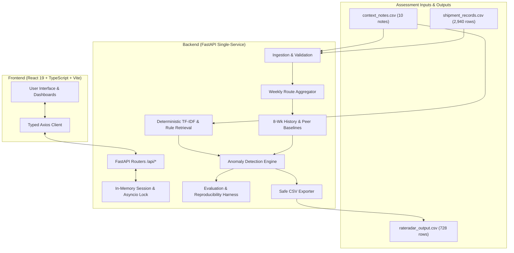

# RateRadar — Freight Cost Intelligence

> **"See the signals behind every freight-rate change."**  

[-success)]()
[]()
[]()
[-blue)]()
[]()

---

## 1. Business Problem & Intended Users

Freight procurement and finance operations teams manage thousands of multi-lane shipments where spot freight rates fluctuate constantly due to diesel price revisions, regional disruptions, driver availability, detour routes, and seasonal spikes. 

**The Core Challenge:** Distinguishing **unexplained, suspicious cost inflation** that demands commercial audit and renegotiation from **legitimate, operationally justified rate changes** backed by real field events.

**Intended Users:**
- **Logistics & Procurement Analysts:** Prioritizing which routes, carriers, and corridors need cost reconciliation.
- **Supply Chain Leadership:** Requiring executive visibility into fleet-wide cost trends and peer benchmarks.
- **Audit & Finance Reviewers:** Needing 100% auditable, bit-for-bit reproducible evidence for invoice adjustments.

---

## 2. Key Features

- **Executive Overview Dashboard:** High-level metrics, fleet-wide cost-per-tonne-km trend visualization, top unexplained rate spikes, and immediate demo data loading.
- **Interactive Route Analysis:** Searchable, filterable, and sortable table covering all 728 route-weeks, with a slide-in drawer showing 8-week historical comparisons and peer route trends.
- **Evidence Explorer:** Transparency view over all 10 context notes, indicating match status, target corridors, and explicit explanations for rejected non-supporting notes.
- **Data Import & Validation:** Drag-and-drop CSV upload with 50MB file-size limits, schema validation, duplicate ID rejection, and row-level diagnostics.
- **Analysis Execution & Transparency:** Configurable anomaly threshold (default 10%), execution timing, and instant 8-column standard CSV export.
- **Verifiable Natural-Language Assistant:** Intent-driven Q&A answering questions regarding route cost hikes, peer comparisons, and supporting notes with zero external LLM API dependency.

---

## 3. Application Screenshots & Visual Tour

> **Note for Evaluators:** Place screenshot images into the [`screenshots/`](screenshots/) directory using the filenames below to render them directly in this document.

| Feature View | Screenshot Link | Core Purpose |
| :--- | :--- | :--- |
| **Executive Overview** |  | High-level metrics, direct action CTAs, 6-corridor quick jump navigator, fleet cost trends |
| **Priority Rate Spikes** |  | Top unexplained rate spikes exceeding 10.0% threshold with compact baseline vs. peer hierarchy |
| **Route Analysis Table** |  | 728 route-week audit table with directional route separation, sorting, and historical drawer |
| **Evidence Explorer** |  | 10 context notes audit with match status, temporal scopes, and rejection reasons |
| **Analysis Execution** |  | Anomaly threshold runner, 9/9 automated evaluation check transparency, and CSV export |
| **Grounded Assistant** |  | Deterministic Q&A grounded in calculated evidence with $0.00 external LLM costs |

---

### Screenshot Gallery Placeholders

#### 3.1 Executive Overview & Freight Intelligence Hero

*Figure 1: Executive Overview dashboard with 6-corridor quick jump navigation chips, fleet average cost-per-tonne-km trend line, and auditable metrics.*

#### 3.2 Priority Unexplained Rate Spikes

*Figure 2: Priority unexplained anomaly queue highlighting rate increases (>10%) against 8-week prior history and peer cohorts.*

#### 3.3 Interactive Route Analysis & Deep-Dive Drawer

*Figure 3: Multi-column searchable route analysis table with slide-in historical comparison drawer and directional route integrity.*

#### 3.4 Evidence Explorer & Note Justifications

*Figure 4: Transparency view over all 10 context notes with explicit justifications for rejected non-supporting notes.*

#### 3.5 Analysis Execution & 9/9 Evaluation Harness

*Figure 5: Configurable threshold runner, 9/9 automated evaluation checks passing, and instant assessment CSV download.*

#### 3.6 Grounded Natural-Language Freight Assistant

*Figure 6: Intent-grounded conversational assistant answering route surge and peer comparison queries with zero hallucination.*

---

## 4. Architecture & Data Flow



---

## 5. Local Quickstart (Non-Docker)

### Prerequisites
- Python 3.11+ (tested on Python 3.11, 3.12, 3.13)
- Node.js 18+ and npm

### Step 1: Clone and Set Up Backend
```bash
# Navigate to backend directory
cd backend

# Create and activate virtual environment
python -m venv venv
# On Windows:
venv\Scripts\activate
# On Linux/macOS:
source venv/bin/activate

# Install dependencies
pip install -r requirements.txt
```

### Step 2: Set Up & Build Frontend
```bash
# In a separate terminal, navigate to frontend
cd frontend

# Install packages
npm install

# Build static assets (produces frontend/dist)
npm run build
```

### Step 3: Run the Single Integrated Service
When `frontend/dist` exists, the FastAPI backend automatically serves the frontend static SPA from root `/`:
```bash
# Inside backend directory with venv activated:
uvicorn main:app --host 0.0.0.0 --port 8000
```
Open **`http://localhost:8000`** in your browser.

*(Optional)* For frontend development with HMR, run `npm run dev` in `frontend` (proxies `/api` calls to `http://localhost:8000`).

---

## 6. Docker Deployment

Deploy the entire full-stack application as a single container using the provided multi-stage Dockerfile:

```bash
# Build and run with Docker Compose
docker compose up --build -d

# Check health status
curl http://localhost:8000/api/health
```
Access the application at **`http://localhost:8000`**.

---

## 7. Analytical Calculations & Contract Compliance

### 7.1 Directional Route Identity (§5.1)
Routes are identified strictly by:
$$\text{Internal Route Key} = \text{origin} \mid \text{destination} \mid \text{route\_type}$$
- `origin` and `destination` are directional: `Mumbai-Pune` is strictly isolated from `Pune-Mumbai`.
- Display and export format is `origin-destination`.
- `route_type` is provided as Short, Medium, or Long.

### 7.2 Weekly Grouping Starting on Monday (§5.2)
Weeks run Monday through Sunday:
$$\text{week\_of} = \text{shipment\_date} - \text{weekday}(\text{shipment\_date})$$
- Formatted as `YYYY-MM-DD`.
- Example: Wednesday `2025-02-26` belongs to Monday `2025-02-24`.
- Correctly handles month and year boundaries.

### 7.3 Cost per Tonne-Kilometre Formula (§5.3)
For each route-week:
$$\text{cost\_per\_tonne\_km} = \frac{\sum \text{freight\_cost\_inr}}{\sum (\text{quantity\_tonnes} \times \text{distance\_km})}$$
*Crucial:* Aggregations occur across the entire cohort first. We never calculate an unweighted mean of individual shipment-level ratios.

### 7.4 Rolling 8-Week Historical Baseline (§5.4)
- **Window:** The 8 calendar weeks strictly preceding the current week: $[\text{week\_of} - 8\text{ weeks}, \text{week\_of})$.
- **No Look-Ahead:** Future weeks or current week data are never included.
- **Limited History Policy:** If fewer than 8 preceding weeks are available, the average is computed across all available earlier weeks. If 0 prior observations exist (e.g. week 1), `own_history_avg` is set to `None` and reported as `N/A (no baseline available for this route's past average)`.
- Percentage deviation:
$$\text{vs\_own\_history} = \left(\frac{\text{current\_cost}}{\text{own\_history\_avg}} - 1\right) \times 100$$

### 7.5 Similar-Route Peer Baseline (§5.5)
- **Peer Set:** Distinct routes in the *same week* that share the *same route_type*.
- **Self Exclusion:** The current route is strictly excluded from its peer group.
- **Metric:** Arithmetic mean of the route-level cost-per-tonne-km metrics of peer routes.
- If no other routes exist for that route type in that week, reported as `N/A`.
- Percentage deviation:
$$\text{vs\_similar\_routes} = \left(\frac{\text{current\_cost}}{\text{peer\_avg}} - 1\right) \times 100$$

---

## 8. Anomaly Classification & Evidence Grounding

### 8.1 Configurable Threshold (§5.6)
The default threshold is **10.0%**. A route-week is an anomaly candidate if:
$$\text{own\_history\_pct} > 10.0\% \quad \text{OR} \quad \text{peer\_pct} > 10.0\%$$
Missing baselines are not treated as zero. If neither baseline is available, the route is not flagged from lack of data alone.

### 8.2 The Flagged States (§5.7)
- **`Yes`**: Anomaly candidate with no valid supporting note. Warrants human investigation.
- **`No (justified)`**: Anomaly candidate where a valid, applicable context note was matched.
- **`No`**: Normal week; costs were within baseline thresholds.

### 8.3 Mandatory Context Retrieval Constraints (§6)
A hybrid TF-IDF candidate ranking + deterministic constraint filter ensures zero false justifications:
1. **Route Applicability:** Note applies to the route directly or to `All Routes`.
2. **Temporal Window:** Note must cover the shipment week:
   - `N001`: Disruption Feb 24 – Mar 8, 2025; roads passable Mar 9.
   - `N002`: Festival surcharge week around Jan 20, 2025.
   - `N003`: Nationwide diesel rise starting May 5, 2025 (bounded to active period).
3. **Strict Exclusion of Non-Supporting Notes:**
   - `N004`: Toll routes not in dataset.
   - `N005`: Highway maintenance note explicitly says costs were not significantly affected.
   - `N006`: Mentions stable demand and no disruptions.
   - `N007`: Road conditions improved after resurfacing (improvements cannot justify cost hikes).
   - `N008`: Normal movement reported.
   - `N009`: Route returned to normal after flood repairs.
   - `N010`: Tracking compliance costs absorbed by transporters without rate change.
   *Under no circumstances can N004–N010 appear in `matched_note_id`.*

---

## 9. Verifiable Natural-Language Assistant (§7)

The Q&A layer is completely grounded in calculated results:
- **Supported Query Types:**
  - *"Why did Chennai-Bangalore become expensive in February 2025?"*
  - *"Which routes have unexplained increases?"*
  - *"Which increases have supporting evidence?"*
  - *"Which routes should an analyst investigate first?"*
  - *"What was the peer comparison for Ahmedabad-Mumbai in January 2025?"*
- **Factual Boundaries:** If asked about an unanalyzed month or non-existent corridor, it reports that data is not found rather than hallucinating an explanation.
- **Cost:** **$0.00 / 0 LLM calls**.

---

## 10. Evaluation Harness & Reproducibility Results

### 10.1 Three-Run Bit-for-Bit Reproducibility (§15)
Ran 3 sequential analytical passes on the complete 2,940-shipment dataset:
- **Run 1 SHA-256:** `f013690e1986a437bebbc5b4b7014616fdc9040239484d6c4d95e06d5694d20f`
- **Run 2 SHA-256:** `f013690e1986a437bebbc5b4b7014616fdc9040239484d6c4d95e06d5694d20f`
- **Run 3 SHA-256:** `f013690e1986a437bebbc5b4b7014616fdc9040239484d6c4d95e06d5694d20f`
- **Result:** **100% Identical Output** across all 728 route-weeks.

### 10.2 Evaluation Harness Checks (§14)
All 9 automated checks passed:
1. Output schema contains all 8 required columns: **PASS**
2. All `matched_note_id` values reference existing notes: **PASS**
3. Every `No (justified)` row has a non-empty `matched_note_id`: **PASS**
4. Non-justified rows leave `matched_note_id` empty: **PASS**
5. All `cost_per_tonne_km` values strictly positive: **PASS**
6. All `week_of` values are valid Monday dates: **PASS**
7. Non-supporting notes (N004–N010) never used as justification: **PASS**
8. Multi-run output hashes match: **PASS**
9. Output produces all 728 route-weeks: **PASS**

---

## 11. Generating the Final Assessment CSV

Run the standalone CLI script to re-generate `rateradar_output.csv` and verify reproducibility at any time:

```bash
cd backend
python generate_artifacts.py
```
Output file created at: **`rateradar_output.csv`** (in repository root).

### Exact Output Schema (8 Columns)
```csv
route,week_of,cost_per_tonne_km,vs_own_history,vs_similar_routes,flagged,matched_note_id,reason
```

---

## 12. Security & Edge Case Handling (§11 & §12)

- **Upload Safety:** Max file size enforced (50MB). Only `.csv` extensions and valid UTF-8/BOM streams permitted.
- **CSV Formula Injection:** Fields beginning with `=`, `@`, `\t`, `\r` are neutralized with a leading `'`. Signed percentage values (`+35.5%`) are safely formatted without extra quotes.
- **Session Isolation:** In-memory session state is guarded by an `asyncio.Lock` to prevent concurrent requests from mixing analysis snapshots.
- **Edge Cases Handled:** Negative freight costs, zero distances, invalid date strings, duplicate shipment IDs, missing baselines, and boundary weeks.

---

## 13. Trade-offs & Limitations (§18)

1. **In-Memory Session State vs Persistent Database:**
   - *Chosen Approach:* In-memory state allows zero-configuration assessment portability without provisioning Postgres or Redis.
   - *Production Recommendation:* In enterprise production with hundreds of concurrent logistics planners, a PostgreSQL database with a TimescaleDB extension and Redis worker queue would back multi-tenant workloads.
2. **Rule-Based Q&A vs Generative RAG:**
   - *Chosen Approach:* Strict entity/intent matching ensures 100% deterministic accuracy with $0 cost.
   - *Production Recommendation:* An optional local small language model (e.g. Llama-3.2-3B via Ollama) can serve as an intent router for conversational queries while strictly citing retrieved SQL/TF-IDF records.

---

## 14. Project Repository Structure

```
RateRadar/
├── AI Intern Case Study/         # Assessment input CSVs & PDF brief
│   ├── shipment_records.csv
│   ├── context_notes.csv
│   └── sample_output_format_v2.csv
├── backend/
│   ├── app/
│   │   ├── aggregation/          # Weekly route aggregation
│   │   ├── api/                  # FastAPI routers (health, data, analysis, assistant)
│   │   ├── assistant/            # Grounded Q&A intent & response engine
│   │   ├── baselines/            # 8-wk history & peer baselines
│   │   ├── detection/            # Deterministic anomaly classifier
│   │   ├── evaluation/           # 9-point correctness validation harness
│   │   ├── exports/              # Safe 8-column CSV generator
│   │   ├── ingestion/            # Strict CSV parsing & validation
│   │   ├── retrieval/            # Deterministic note matching & negative filters
│   │   ├── schemas/              # Pydantic models
│   │   └── services/             # Pipeline orchestration
│   ├── generate_artifacts.py     # CLI execution & reproducibility script
│   ├── main.py                   # FastAPI application entry & static SPA mount
│   ├── pytest.ini                # Pytest configuration
│   ├── requirements.txt          # Python dependencies
│   └── tests/                    # 27 unit and integration tests
├── frontend/
│   ├── src/
│   │   ├── pages/                # Overview, RouteAnalysis, Evidence, DataImport, RunReport, Assistant
│   │   ├── App.tsx               # Shell, navigation, context provider
│   │   ├── api.ts                # Typed Axios API client
│   │   └── index.css             # Design system & tokens
│   ├── package.json
│   └── vite.config.ts
├── screenshots/                  # Project UI screenshots directory
│   ├── README.md                 # Screenshot naming and attachment guide
│   ├── 01_overview_dashboard.png # Executive Overview & Hero
│   ├── 02_priority_rate_spikes.png# Priority Unexplained Rate Spikes
│   ├── 03_route_analysis.png     # Route Analysis Table & History Drawer
│   ├── 04_evidence_explorer.png  # Evidence Explorer & Note Justifications
│   ├── 05_run_report_evaluation.png# Analysis Execution & 9/9 Evaluation
│   └── 06_freight_assistant.png  # Verifiable Natural-Language Assistant
├── rateradar_output.csv          # Final verified 728-row assessment output
├── reproducibility_report.md     # 3-run bit-for-bit audit report
├── token_cost_report.md          # Audited $0.00 / 0-token report
├── evaluation_report.md          # 9/9 harness checks & 27/27 test suite audit
├── walkthrough_outline.md        # 10-minute technical interview demo outline
├── Dockerfile                    # Multi-stage production container
├── docker-compose.yml            # Single-command compose deploy
└── README.md                     # Comprehensive documentation
```
